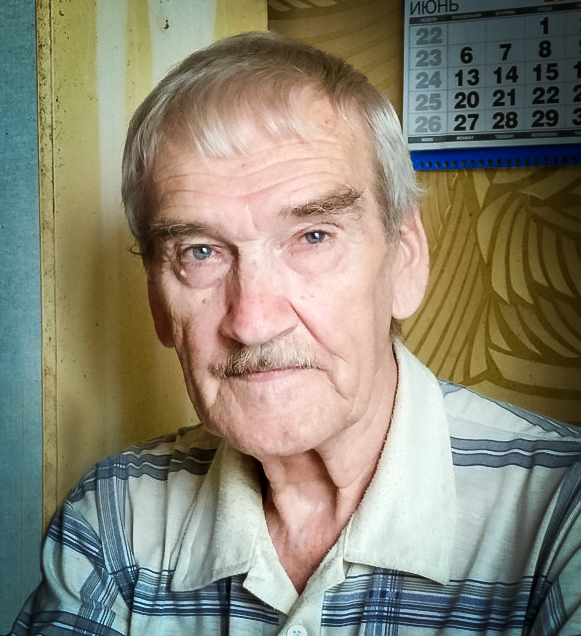
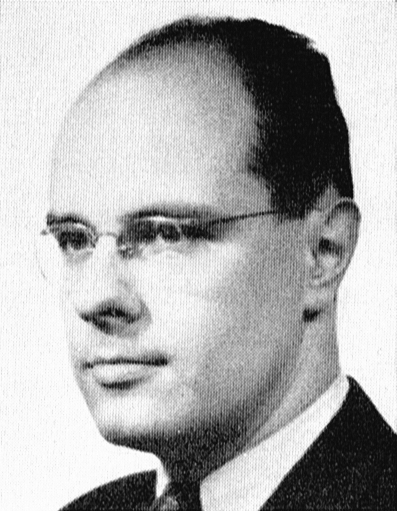
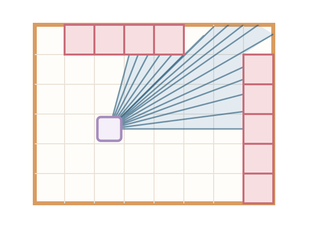
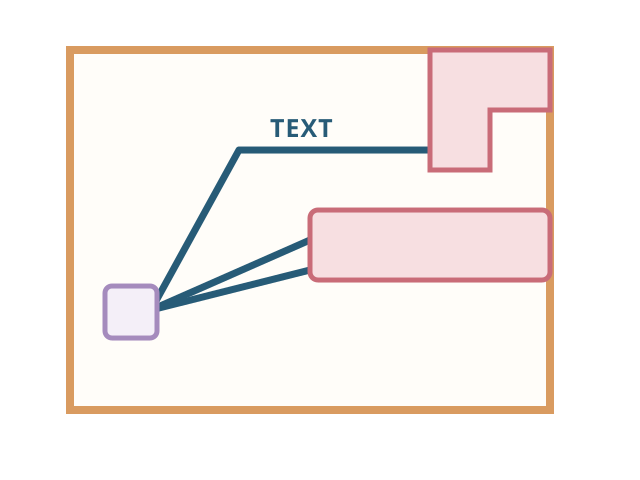
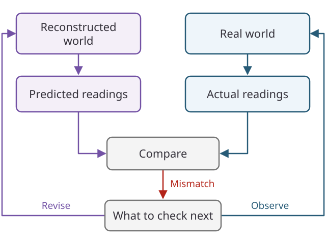

## Petrov

Look out the window and point at the sky.
Go on, point somewhere and with your eyes trace a line upwards.
Somewhere on the line is an intercontinental ballistic missile heading your way.
Reports say it's the Americans. Your name is Petrov, Lieutenant Colonel of Soviet Air Defence Forces.
A siren howls with utmost urgency.

:::dice
13 -- Your heart pounds. The sirens seem to recede into a muffled blur as you reason that the early warning system must be mistaken.
else -- You panic. You freeze up. You cannot muster the courage to even blink.
:::

You report your assessment that the warning is false.
The false alarm is cleared, and no retaliatory strike follows.

This was a real event that happened on September 26, 1983.

> "the [early warning] satellite had been fooled by the sun’s rays reflecting off clouds high over North Dakota, which had two launch areas"
> Source: [The Economist, “Midnight and counting” (30 September 2017)](https://www.economist.com/news/obituary/21729727-man-who-save-world-was-77-stanislav-petrov-was-declared-have-died-september-18th)

<figure>

<figcaption class="photo-credit"><a href="https://commons.wikimedia.org/wiki/User:Queery-54">Queery-54</a> · <a href="https://creativecommons.org/licenses/by-sa/4.0/">CC BY-SA 4.0</a></figcaption>
</figure>

 Petrov rolled a natural 20 that day.
 
> Some of his doubts were logical: the newness of
> the system, and the too-swift passage of the message through the 30 layers of
> verification he had set up himself. Other doubts were vaguer: a funny gut feeling,
> and a sense that he knew better than a machine. Even so, his decision to declare a
> false alarm was a 50-50 guess, no better.
> Source: [The Economist, “Midnight and counting” (30 September 2017)](https://www.economist.com/news/obituary/21729727-man-who-save-world-was-77-stanislav-petrov-was-declared-have-died-september-18th)

Did the sensors betray us? Were the machines immoral? Should the Soviets invest in model alignment?

Safe agentic behavior is on everyone's mind nowadays. 
Funny enough, nearly four months before the Soviet nuclear false alarm incident, the movie WarGames came out with an uncannily similar premise. 

<figure>

<figcaption class="photo-credit"><a href="https://posteritati.com/poster/30644/war-games-1983-us-one-sheet-poster">Theatrical poster</a> · © MGM/UA</figcaption>
</figure>

In both Petrov's case and the movie, humans played a critical role as guardrails for their automated systems.

## Grenander

During the week of _WarGames_' wide release, Ulf Grenander presented “Reflections on Global Tendencies in Mathematics” at a conference in Lund called _An Inventory of Present Thinking about Parts and Wholes_. After all, computers were changing mathematical practice rapidly around this time. 
Wait, since [Math 2.0](https://teorth.github.io/tao-web/slides/math-2-0-caltech-2026.pdf) is taken, let's call his take Math 1.5.

<figure>

<figcaption class="photo-credit"><a href="https://commons.wikimedia.org/wiki/File:Professor_Ulf_Grenander.jpg">Svenskt Porträttarkiv</a> · <a href="https://creativecommons.org/licenses/by-sa/4.0/">CC BY-SA 4.0</a></figcaption>
</figure>

Petrov's false alarm took place in September, months after Grenander's June presentation, and [details of the incident did not become public until the 1990s](https://www.chathamhouse.org/sites/default/files/2022-03/2022-03-07-nuclear-decision-making-unal-et-al_0.pdf). Much of Grenander's mathematical framework, developed during the Cold War, centered on probabilistic pattern representations and inference from signals. These ideas also offer a useful lens for thinking about early-warning systems. One powerful idea is that pattern analysis and pattern synthesis should share a common probabilistic model.

> Pattern analysis = Pattern synthesis.
> (Attributed to Grenander (1983, §5.3) in [“Bayesian Computation and Stochastic Systems”](https://www2.stat.duke.edu/~sschmid/Courses/Stat376/Papers/BCSSStatSci1995.pdf))

Bottom-up signals from sensors may fire an alert warning Petrov of incoming missiles.

Top-down understanding is the process of synthesizing or simulating evidence, and matching those synthetic signals against real signals.

- Why would the United States launch only five missiles rather than an overwhelming first strike?
- Why should he trust a relatively new warning system?
- Why wasn't there corroborating evidence from ground radar?

If we can construct models of the processes that could have generated the signals, then we better understand our world.
His compositional and probabilistic framework for representing the underlying structures and inferring them from observations was called Pattern Theory. 

Whatever happened to Pattern Theory?

## Hermès

<figure>

<figcaption class="photo-credit">© RTL Today</figcaption>
</figure>

Six weeks before the conference and _WarGames_' wide release, Munich hosted the 28th edition of the Eurovision Song Contest.

Corinne Hermès stunned us with her song "Si la vie est cadeau", representing Luxembourg and winning 1st place. 

She sings:

<iframe src="https://www.youtube.com/embed/F8y5xc8UodE" title="Corinne Hermès performing ‘Si la vie est cadeau’ at Eurovision 1983" style="position: absolute; inset: 0; width: 100%; height: 100%; border: 0;" allow="accelerometer; autoplay; clipboard-write; encrypted-media; gyroscope; picture-in-picture; web-share" referrerpolicy="strict-origin-when-cross-origin" allowfullscreen></iframe>

> Cadeau donné, cadeau repris, cadeau volé

It translates to "a gift given, a gift taken back, a gift stolen."

In fact, in her later interviews after the competition, Hermès does not explicitly say that Grenander's Pattern Theory was the gift.

But that's how I read it, because get this: Grenander's approach differed from neural-network backpropagation. [Backpropagation predated 1986](https://www-isl.stanford.edu/~widrow/papers/c1992backpropagationand.pdf); the influential paper by Rumelhart, Hinton, and Williams that year helped popularize it. 

In his [1985 account](https://pure.iiasa.ac.at/id/eprint/2589/1/XB-85-406.pdf), Grenander described pattern inference as stochastic relaxation: repeatedly resampling local parts of a pattern to form a Markov chain. Later, he and Michael Miller developed [jump-diffusion methods](https://doi.org/10.1111/j.2517-6161.1994.tb02000.x) for sampling Bayesian pattern models. 

Maybe it's cliche now, but you may have heard the phrase "the map is not the territory." 
To me, it means the patterns we analyze and the signals our sensors capture are only projections of reality, not to be confused with reality itself.

I think that's what Hermès means when she sings,

> Alors pourquoi m'avoir promis la terre entière?

It translates to, "so why did you promise me the whole world?"

To which Claude responds, "That was an honest mistake, and you're right to push back on that."

In many ways, an LLM's output resembles the warning from the Soviet early warning system. 
Petrov had a rich model of the world in his head that allowed him to be skeptical of the sensor readings. 
As Grenander put it, the key idea is "analysis by synthesis."

## Analysis by synthesis

Consider a grid world, where an agent can use optical sensors to measure distance to obstacles.

The blue vision cone represents the measurement of sensor signals. 

One problem with using LLMs for agentic planning is that they can conflate the map with the territory.

The LLM is the sensor. 
I've seen related questions raised in [a paper that models language as a sensor](https://arxiv.org/pdf/2606.08666) and in [an argument that LLMs do not yet transmit testimonial knowledge](https://www.cambridge.org/core/journals/episteme/article/assertion-without-a-speaker-testimony-tracking-and-large-language-models/6F19C8DC4ECBD9FA0E43BA300DA45AF1). 
When the sensor becomes the planner, we confuse the signals with reality.
A trustworthy agentic system shall reconstruct a generative explanation of reality that predicts observations it has never seen.

For example, the agent reconstructs a possible world and predicts the sensor readings that world would produce. It compares those predictions with the real readings, then uses the mismatches to decide what to investigate next.

Its imagined world gives it questions to ask the real one.

An AI catastrophe could begin with a sensible plan for an imagined world, so reality must have a chance to interrupt the plan before the agent does something irreversible.

I aim to return to this discussion in the future, as I am now running out of time to checkpoint my thoughts.
