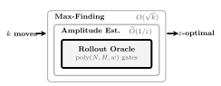
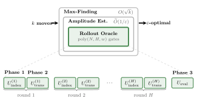
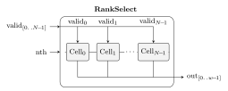
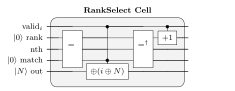
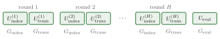

# Introduction {#seg-opening}

## Coherent Rollout Oracles for Finite-Horizon Sequential Decision Problems {#title .center}

### Nishant Shukla

nxs@ucla.edu

IEEE Quantum Week 2026 (QCE26), Toronto

::: {#l2-shared}
:::

<!-- Paper: [arxiv.org/abs/2604.25962v1](https://arxiv.org/abs/2604.25962v1){target="_blank" rel="noopener"} -->

## The Selection Problem {#selection-problem .center}

::: {#eps-band}
:::

$$\Pr\bigl[\,v_{\hat{a}} \geq \max_j v_j - \varepsilon\,\bigr] \geq \frac{2}{3}$$

<!-- aka multi-arm bandit -->

## Speedup {#speedup .center}

::: {.columns}
::: {.column}
Quantum

$$\widetilde{O}(\sqrt{k}/\varepsilon)$$
:::
::: {.column}
Classical

$$\Omega(k/\varepsilon^2)$$
:::
:::

[Wang et al.](https://doi.org/10.1609/aaai.v35i11.17212){target="_blank" rel="noopener"}

<!-- Wang et al. prove the bound for any k arms, conditional on the access model: given each arm as a unitary with its inverse, whose amplitude encodes the arm's mean, $\widetilde{O}(\sqrt{k}/\varepsilon)$ queries find an ε-best arm. Whether a problem fits that form, and at what cost, is outside the theorem. -->

## "Assume oracle access." {#assume-oracle-access .center}

::: {#oracle-collage}
:::

## Obstacle {#obstacle}

- Randomness in explicit registers
- Unitary, invertible rollout step
- Selector to valid action, without measurement or rejection
- Branch-dependent valid actions
- Sentinel when the rank is out of range

## Contribution 1 {#rank-select-decoder}

### A coherent rank-select decoder for branch-dependent valid actions

- We give two coherent rank-select constructions, both using $O(w)$ clean ancillae: a sequential scan with $O(Nw)$ gates that is optimal in the bounded-span model, and a blocked construction with $O(N \log w)$ gates that exploits long-range connectivity.
- The unconditional gate lower bound across all layouts is $\Omega(N)$.
- To our knowledge, this is the first reversible-circuit complexity analysis of coherent rank-select under branch-dependent validity.

<!-- $N$ is the number of positions per round, so the validity mask is $N$ bits.

$w = \lceil\log_2(N{+}1)\rceil$ is the selector width: enough bits for any position, or the sentinel $N$. -->

## Contribution 2 {#rollout-oracle}

### An explicit polynomial-size coherent rollout oracle for implicit-state finite-horizon planning

- We decompose the oracle into three reversible phases (rank-select indexing, stochastic transition, terminal evaluation) that compose into a polynomial-size unitary, with gate-count and qubit-count formulas per call.
- Plugged into the pipeline of Wang et al., the oracle yields an explicit rollout algorithm using $\widetilde{O}(\sqrt{k}/\varepsilon)$ coherent calls.
- It is implemented in Qiskit with branchwise agreement against classical rollouts on all tested instances.

<!-- The oracle simulates one trajectory, so its cost scales with the length of a state, $N$ cells for $H$ rounds, never with the number of states, which is $3^N$.

Explicit methods carry a value for every state and pay for all $3^N$. -->

## Contribution 3 {#lower-bound-robustness}

### Lower-bound robustness across exponentially many configurations

- A bounded-influence lifting theorem and a per-configuration transfer theorem carry the classical $\Omega(k/\varepsilon^2)$ hard construction from a base configuration to every member of an exponential family of locally coupled configurations.

# Preliminaries {#seg-preliminaries}

## Preliminaries {#preliminaries .center}

## Recurring notation {#notation}

|                  |                             |                 |                                |
|------------------|-----------------------------|-----------------|--------------------------------|
| $k$              | arms (first actions)        | $v_i$           | value of action $i$            |
| $\varepsilon$    | accuracy target             | $H$             | rollout horizon                |
| $N$              | positions per round         | $w$             | $\lceil\log_2(N{+}1)\rceil$    |
| $M_s$            | validity mask in state $s$  | $r$             | rank into $M_s$                |
| $C^*\!,\, a^*$   | witness config., action     | $\mathcal{F}$   | peripheral family              |
| $Q$, $\delta_u$  | peripheral set; influence   | $\beta$         | $\sum_{u\in Q}\delta_u$        |

# A Normal Form for Coherent Rollout Oracles {#seg-normal-form}

## A Normal Form for Coherent Rollout Oracles {#normal-form .center}

## Three reversible phases {#three-phases .center}

$$U \;=\; U_{\mathrm{eval}} \cdot \prod_{h=H}^{1}\bigl(U_{\mathrm{trans}}^{(h)} \cdot U_{\mathrm{index}}^{(h)}\bigr)$$

<!-- To provide the innermost level used by amplitude estimation in Figure 1, we need an explicit unitary circuit that simulates a complete rollout. This section constructs one by decomposing it into three reversible phases that compose into a single oracle. -->

## Phase 1: Coherent Rank-Select Indexing {#rank-select .center}

$$\lvert s\rangle\lvert r\rangle\lvert 0\rangle^{\otimes w} \;\mapsto\; \lvert s\rangle\lvert r\rangle\lvert j_s(r)\rangle$$

::: {#rank-select-example}
:::

$$j_s(0) = 1,\quad j_s(1) = 2,\quad j_s(2) = 4,\quad j_s(r) = 8 \text{ for } r \geq 3$$

## RankSelect {#rankselect .center}

## RankSelect Cell {#rankselect-cell .center}

## Gate bounds {#gate-bounds}

|                 | Gates          | Ancillae | Model                      |
|-----------------|----------------|----------|----------------------------|
| Sequential scan | $O(Nw)$        | $O(w)$   | bounded-span, gate-optimal |
| Blocked         | $O(N \log w)$  | $O(w)$   | long-range gates           |
| Any circuit     | $\Omega(N)$    |          | bounded fan-in             |

## Rank-select cut lower bound {#cut-lower-bound .center}

::: {#cut-protocol}
:::

$$j = t + (t{-}1{-}a) \quad\Rightarrow\quad \lceil \log_2 \min(t, N-t) \rceil \text{ bits across cut } t$$

<!-- Alice holds the prefix, Bob the suffix and the rank. With Bob's side all ones and rank $t-1$, the answer lands at $j = t + (t-1-a)$: its position is $a$.

Naming $a$ takes $\lceil \log_2 \min(t, N-t) \rceil$ bits; every left-to-right scan carries that past each cut.

A bounded-span gate moves $O(1)$ bits across $O(1)$ cuts: $N$ cuts times $\log N$ bits is $\Omega(Nw)$, the scan's cost. A long-range gate spans many cuts at once: the blocked construction's escape. -->

## Phase 2: Reversible Stochastic Transition {#transition .center}

::: {#transition-strip}
:::

$O(1)$ per cell, $O(N)$ per round

## Phase 3: Coherent Terminal Evaluation {#terminal-evaluation}

$$\Pr[\text{payoff} = 1] = v_i$$

- Local predicates: $O(N)$
- Comparing two $w$-bit counts: $O(N^2 w)$

## Per-Call Gates {#per-call-gates .center}

$$G_{\mathrm{call}} = H\,(G_{\mathrm{index}} + G_{\mathrm{trans}}) + G_{\mathrm{eval}}$$

Bounded-span $O(HNw + N^2 w)$, long-range $O(HN \log w + N^2 w)$

## Per-Call Qubits {#per-call-qubits .center}

::: {#register-layout}
:::

$$Q_{\mathrm{call}} = (H{+}1)Ns + Hw + HNd + q_{\mathrm{anc}}$$

$s$ configuration state width, $d$ dice width

# Classical Lower Bound {#seg-classical-lower-bound}

## Classical Lower Bound {#classical-lower-bound .center}

## Base and alternative {#base-alternative .center}

::: {#two-worlds}
:::

<!-- The two worlds are identical except for arm $j$, boosted from $\tfrac{1}{2}$ to $\tfrac{1}{2} + 6\varepsilon$, just past arm 0 at $\tfrac{1}{2} + 4\varepsilon$, so arm $j$ is the only ε-good answer there.

One alternative per contender: $k-1$ of them. -->

## Change of measure {#change-of-measure .center}

::: {.columns}
::: {.column}
Information needed

$$\mathrm{kl}\bigl(\tfrac{1}{3}, \tfrac{2}{3}\bigr) = \frac{\ln 2}{3}$$
:::
::: {.column}
Information per rollout

$$\mathrm{kl}\bigl(\tfrac{1}{2}, \tfrac{1}{2} + 6\varepsilon\bigr) \leq 96\,\varepsilon^2$$
:::
:::

$$\mathbb{E}_0[N_j] \;\geq\; \frac{\ln 2 / 3}{96\,\varepsilon^2} \;=\; \frac{\ln 2}{288\,\varepsilon^2}
\qquad\qquad
\mathbb{E}_0[\tau] \;\geq\; \frac{(k-1)\ln 2}{288\,\varepsilon^2} \;=\; \Omega\!\left(\frac{k}{\varepsilon^2}\right)$$

[Kaufmann, Cappé, Garivier 2016](https://jmlr.org/papers/v17/kaufman16a.html){target="_blank" rel="noopener"} · [Lattimore, Szepesvári 2020](https://doi.org/10.1017/9781108571401){target="_blank" rel="noopener"}

<!-- kl is the divergence between two coins.

A correct algorithm outputs arm 0 two thirds of the time in the base world and one third in the alternative; telling those coins apart takes $\ln 2 / 3$ nats.

One rollout of arm $j$ is a one-half coin against a one-half-plus-$6\varepsilon$ coin, at most $96\varepsilon^2$ apart.

Divide: at least $\ln 2 / 288\varepsilon^2$ pulls of arm $j$.

Times $k-1$ contenders, $\Omega(k/\varepsilon^2)$. -->

## Bounded-influence lifting {#lifting .center}

::: {#lifting-boards}
:::

$$\mathbb{E}_{C}[\tau] \;\geq\; \frac{(k-1)\,\ln 2}{288\,\varepsilon^{2}} \;=\; \Omega\!\left(\frac{k}{\varepsilon^{2}}\right) \qquad \text{for every } C \in \mathcal{F}$$

<!-- Arm values depend only on their support regions $R_i$, the boxed cells; $Q$ is every other cell.

With modularity, every member of $\mathcal{F}$ has the base value profile: the two worlds and the count recur at all $|\Sigma|^{|Q|}$ configurations.

The theorem has $3c\,\varepsilon^2$ in place of 288; $c\,\varepsilon^2$ bounds what one rollout of a boosted arm leaks, and here $c = 96$.

With stability alone, values move at most $\beta \leq \varepsilon$ and the gap survives at $\varepsilon$. -->

## Subcritical influence decay {#influence-decay .center}

::: {#influence-decay}
:::

$$\delta(d) \;\leq\; \frac{\kappa}{\kappa-1}\,\bigl((\kappa-1)\,p\bigr)^{d} \qquad \kappa p < 1$$

<!-- Couple two runs that differ at one cell. The disagreement reaches an arm only along a non-backtracking walk, each step with probability $p$.

At most $\kappa(\kappa-1)^{d-1}$ walks of length $d$, so length-$d$ paths contribute $\kappa(\kappa-1)^{d-1}p^d$; over $H$ rounds the sum is a binomial tail, small once $d > H\kappa p$.

Sway: $\kappa = 4$, $p = 1/20$, ratio $3/20$.

The halo still has to fit on the board; at $H = 30$ on $20 \times 20$ it does not. -->

# Quantum Upper Bound {#seg-quantum-upper-bound}

## Quantum Upper Bound {#quantum-upper-bound .center}

# Instantiation {#seg-instantiation}

## Instantiation {#instantiation .center}

## Sway benchmark {#sway .center}

::: {#sway-icons}
:::

<!-- Sway is a two-player stochastic game on an $m \times m$ grid with three cell states (black, white, empty).

Each round, players place pieces on empty cells (branch-dependent validity), then each occupied cell flips with probability $(4-c)/20$ via a per-cell $d_{20}$ roll, where $c$ is the count of same-color orthogonal neighbors, with binary terminal payoff (black outnumbers white). -->

## Follow one Sway rollout {#rollout-sway}

::: {#rollout-sway}
:::

<!--
Fix the first move, then simulate the remaining rounds.

At the end, record the payoff bit.

Reset the board and repeat with fresh random choices.

**The average estimates Black's win probability under this policy.**

**Each possible first move is one candidate action, also called an arm.**
-->

## What carries over to the epidemic model? {#transfer}

::: {#l2-transfer}
:::

<!--
**The model supplies three operations: identify valid actions, update the state, and evaluate the outcome.** Advance to replace those three pieces one at a time. **The outer circuit structure stays visible while the model-specific operations change.**

The epidemic model has a different transition rule and payoff, so its resource counts differ too.
-->

## Oracle correctness check {#correctness}

| Domain | Instance              | Qubits | Depth  | Gates  | MC Payoff        | Exact |
|--------|-----------------------|-------:|-------:|-------:|:----------------:|:-----:|
| Sway   | $3{\times}3, H{=}2$        | 169    | 3 079  | 9 768  | $.281 \pm .028$  | $.271$ |
| Sway   | $5{\times}5, H{=}3$        | 667    | 18 258 | 55 597 | $.337 \pm .021$  | $.325$ |
| Epi.   | $3{\times}3, H{=}2, T{=}2$ | 146    | 2 383  | 6 472  | $.883 \pm .020$  | $.891$ |

## Direct compiled resource counts {#scaling}

| $m$ | $H$ | $N$ | Qubits, Sway | Qubits, Epi. | Gates, Sway | Gates, Epi. |
|----:|----:|----:|-------------:|-------------:|------------:|------------:|
| 5   | 5   | 25  | 916          | 767          | 76 720      | 56 602      |
| 7   | 5   | 49  | 1 708        | 1 452        | 180 615     | 124 735     |
| 10  | 5   | 100 | 3 363        | 2 893        | 481 201     | 280 230     |
| 10  | 10  | 100 | 6 503        | 5 463        | 793 901     | 558 995     |
| 20  | 10  | 400 | 25 189       | 21 409       | 6 072 641   | 2 592 183   |

Pre-decomposition, before fault-tolerant overhead

# Conclusion {#seg-conclusion}

## Conclusion {#conclusion}

- Reversible rollout oracle: $\widetilde{O}(\sqrt{k}/\varepsilon)$ calls, $O(w)$ clean ancillae
- Classical floor $\Omega(k/\varepsilon^2)$, at every member of an exponential family
- Coherent rank-select: scan $O(Nw)$, gate-optimal under bounded span; blocked $O(N \log w)$
- Open: $\Omega(N)$ vs $O(N \log w)$; lifting beyond $\kappa p < 1$; closed-loop policies
